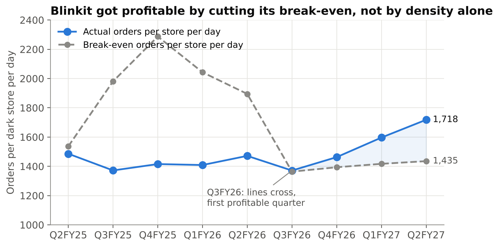
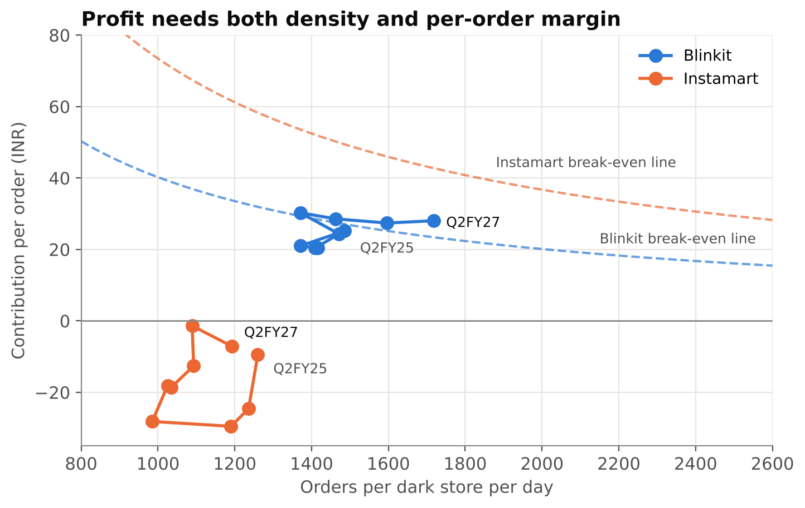
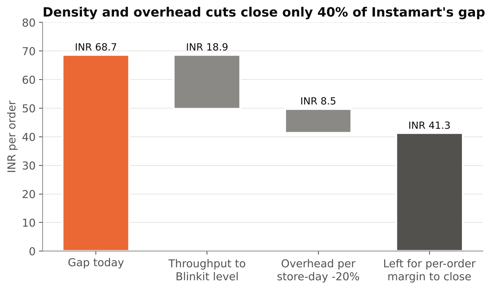

# Quick-Commerce Dark-Store Economics: Blinkit vs Swiggy Instamart

**Answer first: quick commerce profitability is won on margin per order, not on density alone.** Blinkit turned profitable mainly by earning more on each order, which pulled its break-even point down. Instamart loses money on every order, so more orders per store cannot fix it by themselves.

Built from **9 quarters (Q2FY25 to Q2FY27) of the companies' own shareholder letters**: 180 reported data points, a store-day P&L model in Python and Excel, and a 10-slide answer-first deck.

| | Blinkit | Instamart |
| --- | --- | --- |
| Orders per dark store per day (Q2FY27) | 1,718 | 1,192 |
| Contribution per order | ₹28.0 | −₹7.1 |
| Overhead per store per day | ₹40,228 | ₹73,436 |
| **Break-even orders per store per day** | **1,435** (runs 20% above it) | **None while contribution is negative** |
| Extra contribution per order needed to break even | Already profitable since Q3FY26 | **₹68.7** (9.7% of basket) |

## Key findings

1. **Blinkit cut its break-even, it did not just add orders.** Throughput stayed at ~1,370 to 1,490 orders per store per day for six quarters. Break-even fell from ~2,290 to ~1,360 as contribution per order rose from ₹20 to ₹30. The lines crossed in Q3FY26, Blinkit's first profitable quarter.
2. **Blinkit earns ₹35 more on every order than Instamart.** Instamart has not had a positive contribution in any of the 9 quarters.
3. **Density closes only part of Instamart's gap.** Matching Blinkit's 1,718 orders per store per day closes ₹18.9 of the ₹68.7 gap, and a 20% cut in overhead per store-day another ₹8.5. The remaining **₹41.3 per order (5.8% of basket)** must come from take rate, ad income, 1P margins and lower discounts.
4. **Blinkit's next leg is also margin.** A 5% Adjusted EBITDA margin at today's density needs ~₹50 of contribution per order, against ₹28 today.





## Method

Everything rests on one identity per dark store per day:

```
EBITDA per store-day = orders per store-day × contribution per order − overhead per store-day
Break-even orders per store-day = overhead per store-day ÷ contribution per order
```

*Overhead* is everything between Contribution and Adjusted EBITDA (brand marketing, corporate costs, rent), spread over store-days.

1. **Collect.** Quarterly metrics come from Annexure A of Eternal's letters and the quick-commerce tables and highlights of Swiggy's letters. The letters were parsed with pdf.js; tables published as images were read and typed in by hand. Every row in `data/` cites its letter.
2. **Convert.** Quarterly totals become store-days, contribution per order and overhead per store-day (`model/model.py`).
3. **Test.** Automated checks rebuild reported EBITDA exactly from the identity, rebuild Instamart's reported GOV (₹7,022 Cr and ₹9,230 Cr) from orders × AOV, and confirm Blinkit sits below break-even in every loss-making quarter and above it in every profitable one (`tests/`).

## Deliverables

| File | What it is |
| --- | --- |
| `deck/QCommerce_Dark_Store_Economics.pdf` | 10-slide answer-first deck (PowerPoint version alongside) |
| `outputs/qcommerce_store_day_model.xlsx` | Excel model with live formulas, sourced inputs in blue, editable lever assumptions |
| `outputs/store_day_pnl.csv`, `outputs/results.json` | Model outputs |
| `data/*.csv` | Reported inputs with a source on every row |

## Run it

```bash
pip install -r requirements.txt
python -m model.model        # store-day P&L, break-even, levers -> outputs/
python -m model.charts       # charts -> outputs/charts/
python -m model.build_excel  # Excel model -> outputs/
pytest                       # 6 checks
node deck/build_deck.js      # deck (needs: npm install pptxgenjs)
```

## Limitations

- Overhead is treated as fixed per store-day; in reality part of it scales with orders, so break-even points are estimates.
- Blinkit's AOV is net of discounts; Instamart's is on GOV (before discounts). Rupee-per-order comparisons are like for like; % of AOV comparisons across the two are not.
- Instamart GOV is rebuilt as orders × AOV (within 0.1% of reported); quarterly orders for Q2FY25 and Q3FY25 are reported rounded.
- Swiggy's 1P (own inventory) shift and Blinkit's move to inventory-led accounting change revenue lines, which is why the model works from Contribution and Adjusted EBITDA, not revenue.

## Sources

- [Eternal Shareholders' Letter Q2FY27](https://b.zmtcdn.com/investor-relations/Eternal_Limited_Shareholders_Letter_Q2FY27_Results.pdf) and [Q2FY26](https://b.zmtcdn.com/investor-relations/Eternal_Shareholders_Letter_Q2FY26_Results.pdf), Annexure A
- [Swiggy shareholder letters, Q2FY25 to Q2FY27](https://www.swiggy.com/corporate/investor-relations/financial-results/)
- Market context: Bain & Company and Flipkart, *How India Shops Online 2025*
